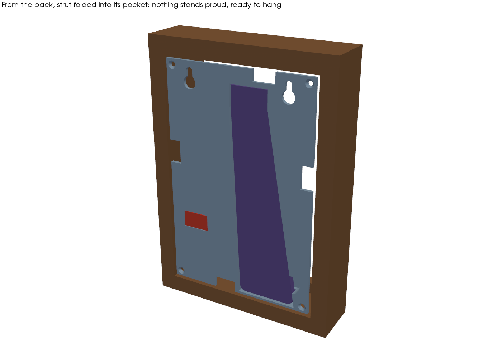
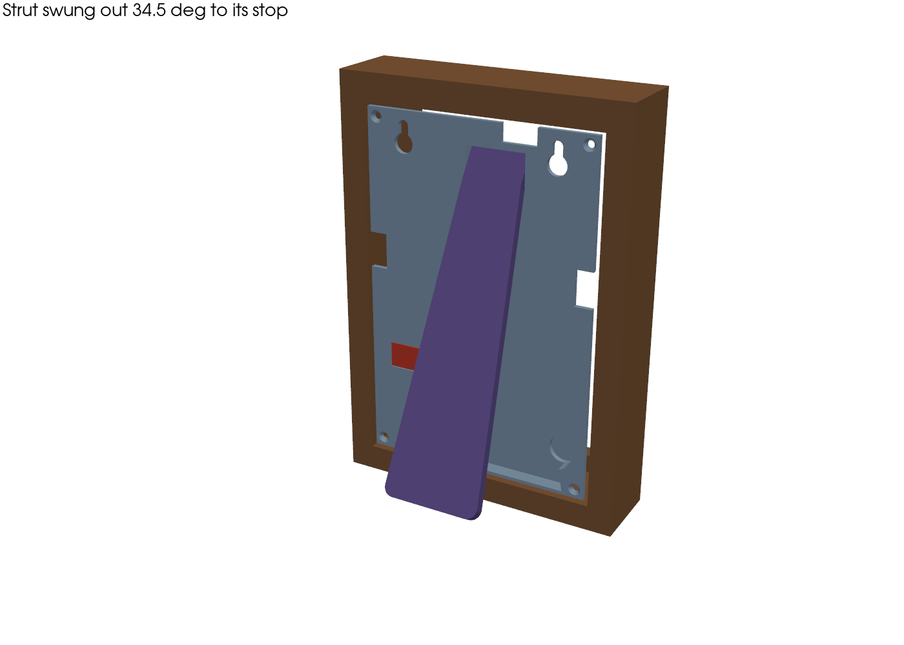
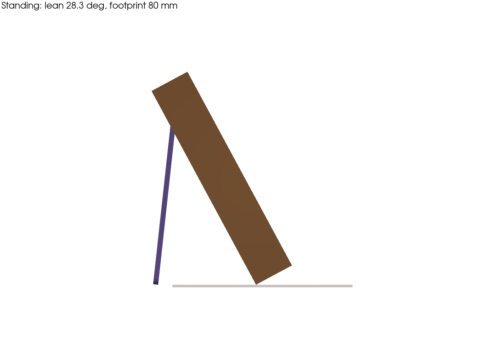
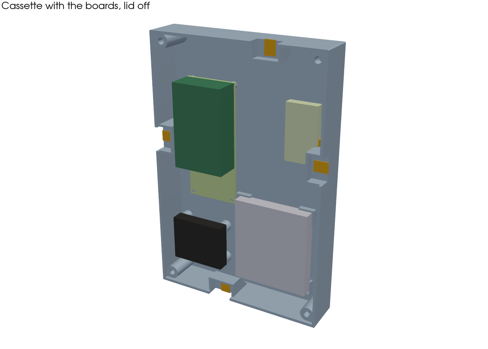
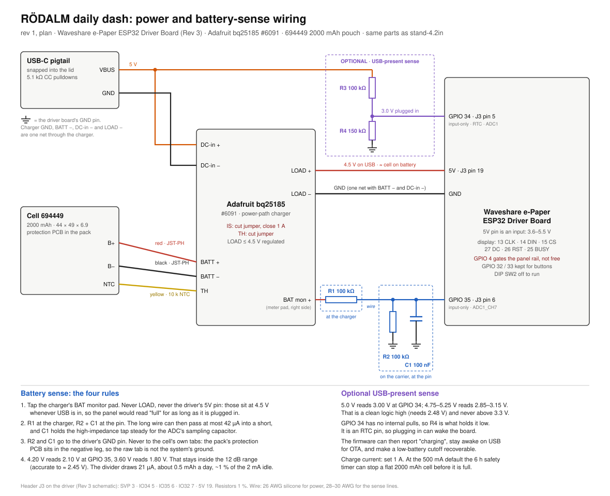

# RÖDALM 4×6 frame for the daily dash

This moves the 4.2" daily-dash panel out of the printed desk stand
([`../../stand-4.2in/`](../../stand-4.2in/README.md)) and into an **IKEA RÖDALM 4×6 frame**
(walnut effect, 205.488.62). The electronics stay the same. What changes is that IKEA's
moulding becomes the outer shell, and the printed parts turn into an insert that drops into it.

**Status: coupons printed and fitting; ready to print the parts.** One parametric build123d
file, [`src/rodalm_frame.py`](src/rodalm_frame.py), builds four parts plus fit coupons. It
runs 59 interference checks (all clear), counts one body per part, and writes 3MF and STEP
files. The coupons confirmed the rebate fit, all four tab ledges at 17.5, and the ribbon path.

**The back is flush.** With the strut folded into its pocket, nothing stands behind the
frame's back edge, so it can hang on a wall from the keyholes. Four checks hold that line:
the cassette, the lid, the folded strut and the USB-C flange each against the space behind
the back plane.

| | |
|---|---|
| [`3mf/rodalm-frame.3mf`](3mf/rodalm-frame.3mf) | **One OrcaSlicer project with every part**, on three named plates, already in print orientation. No rotating, no supports (the lid's pocket floor is a bridge: see Printing) |
| [`slicer/orca_project_settings.config`](slicer/orca_project_settings.config) | Your AD5M Pro presets, copied from the stand's Orca projects; the 3MF carries them |
| [`step/`](step/) | Each part, plus `rodalm-assembly.step` with the boards, for Fusion |
| [`renders/`](renders/) | Built from the model by `tools/render.py` |
| [`schematics/power-and-battery-sense.svg`](schematics/power-and-battery-sense.svg) | Power path, battery sense and USB-present sense |
| [`drawings/layout-sketch.svg`](drawings/layout-sketch.svg) | The plan-stage sketch. The model is the source of truth |

 
 

Tags: **(I)** IKEA's listing, **(F)** measured on the frame, **(M)** measured on the stand
build.

## Building

```bash
pip install build123d
python3 src/rodalm_frame.py          # build, check, write 3mf/rodalm-frame.3mf and step/
python3 src/rodalm_frame.py check    # checks only
python3 src/rodalm_frame.py params   # the derived numbers
python3 tools/render.py              # renders/ (needs pyvista)
```

The script prints its derived numbers first, so a parameter change shows its consequences
before anything is written. Every check is a volume, `(a & b).volume`: an empty intersection
is 0.0, not a missing file. The swept strut check expects contact 1° past the swing (34.5°),
because that's the heel landing.

**Coordinates**, from the file's header: seen from the **back**, X runs toward the ribbon
side, Y is up, and Z is depth from the inside face of the frame's front lip. From the front,
X is mirrored, so the ribbon side is on your left.

---

## The frame

| | |
|---|---|
| Outside | 4¾ × 6¾ × 1¼ in = 120.7 × 171.5 × 31.8 (I) |
| Rebate | **100 × 150** (F) |
| Sight opening | **85 × 135** (F). The front lip covers 7.5 a side |
| Inside depth | **25.0**, from the lip's inside face to the back edge (F). So the front is 6.75 thick |
| Clear cover | Polystyrene, 1.0 (F) |
| Removed | Spacer (12), stock mat (1.5, opening too tall for the glass), backboard (3, its stand is stamped in) |
| Tabs | 4 metal tabs, ~8 long (F). Read from the back: top at ⅔ across, left and right ⅗ up, bottom ⅖ across. They fold at ≈ 17.5 from the inside front, which is the stock stack 1 + 12 + 1.5 + 3 |
| Moulding | Fibreboard with a paper foil. Nothing screws into it |

## Architecture: mat, cassette, lid

Front to back inside the moulding: **cover → mat with the glass in its back → cassette (every
board) → lid.** The frame's own tabs clamp the stack against the front lip.

1. **The mat carries the glass.** The glass pocket is in the **back of the mat**, so the mat
   prints face down with nothing bridging, and the window and glass are located by one part.
   The cassette's flat floor presses the glass into the mat through 0.3 of foam.
2. **Everything lives on the cassette.** The FPC adapter, carrier and driver, charger and cell
   are all on one part. Only two soft wires cross to the lid. The panel's short tail never
   crosses a joint, which was the stand's hardest problem. The mat and cassette run on the
   bench outside the frame.
3. **The driver faces the lid**, so with the lid off the DIP switch and flashing USB-C are
   right there.
4. **The tabs reach in through wells.** The tab plane (17.5) cuts through the driver stack, so
   each tab gets a 14 × 8.7 well open to the back, floored by a solid **ledge at 17.5**. The
   blocks under the ledges have 45° undersides: they print without support and stay clear of
   the tail and the cell near the floor. The tabs are bent **once**. The lid comes off with
   four screws and never touches them.
5. **Nothing goes into the moulding.**

## Depth

| | From | To |
|---|---|---|
| Cover (F) | 0 | 1.00 |
| Mat face 1.2 + glass pocket 1.05 | 1.00 | 3.25 |
| Foam under the glass | 3.25 | 3.55 |
| Cassette floor | 3.55 | 4.95 |
| Air under the carrier (`CARRIER_LIFT` 1.5) | 4.95 | 6.45 |
| Carrier + sockets + driver (M, 16.0) | 6.45 | 22.45 |
| Clearance | 22.45 | 22.95 |
| Lid | 22.95 | **24.95** |

The frame is 25.0 deep inside, so **the lid sits 0.05 inside the back edge: flush**. The
strut's pocket reaches into the cassette below the lid, down to **17.5**, but only right of
the driver, where the tallest thing is the cell (12.35). See the next section. Getting
there cost two things against the plan: the floor went from 1.6 to 1.4, and the air under the
carrier from 2.5 to 1.5. **So the header tails under the carrier have to be flush-cut to
under 1.5, solder included.** If you'd rather not, set `CARRIER_LIFT = 2.5` and the lid stands
1 mm proud of the back edge. Nobody sees that from the front, and nothing else moves.

## Layout, seen from the back

| Part | Where (X, Y) | Notes |
|---|---|---|
| Glass | centre (3.2, 0) | Offset so the ink is centred: the ribbon border is 9.4, the other 3.0 |
| Floor opening | adapter window + ribbon relief, one hole | The tail lies on the glass back exactly as in the stand |
| FPC adapter 18 × 32 × 5 (M) | 21.2…39.2, 10.5…42.5 | Taped to the glass through the opening |
| Carrier 30 × 70 + driver | −39…−9, −22…48 | Four pegs, flush with the board's top (a peg standing proud would meet a header body). Driver on the top 48, socket edge toward the adapter, **antenna end up** |
| bq25185 | −46…−14, −62…−35.7 | Four Ø6.5 posts, 4.5 tall, with M2 inserts |
| USB-C pigtail | (−31, −29.25), in the lid | The 6-wire part's panel hole, **13.6 × 6.3**, R1.3 corners (from the stand's `.scad`; its README's 14.3 × 5.0 is older) |
| Cell 44 × 49 | −6.5…37.5, −66…−17 | L-shaped corner fences, 3 tall |
| Corner bosses | (±44.1, ±69.1) | Ø8, with M2.5 inserts for the lid |
| Tab wells | top X 16.7 · bottom X −10 · left and right Y 15 | 14 wide, so a tab can be a few mm off and still land |
| Strut pocket (in the lid) | hinge −8.4…22.4 at the top, foot −1.3…39.8 at the bottom; Y −72.7…64.1 | A tub under the lid, 17.5…22.95. Right of the driver, over the cell, between the bottom tab well and the bottom-right boss. **The FFC from the adapter to the driver has to run under it**, below 17.5 |

## Back: lid, strut, hanging

- **Lid:** 2.0 thick, inside the cassette walls, on 4 × **M2.5 countersunk** screws. Notched
  over the four tab wells. Two **keyholes** at (±32, 60): the screw head goes in through the
  Ø8 hole and the frame drops onto the 4.2 slot. The head ends up inside the cassette, where
  there's clear space.
- **USB-C, recessed.** The pigtail's flange sits in a pocket, flush with the lid's back, on a
  2.0 panel like the stand's (a boss under the lid carries it). The body reaches 12 into the
  cassette, clear of the charger and the driver. A straight plug still stands out of the back,
  so on a wall it runs on the cell, or on a right-angle plug.
- **Easel strut**, replacing the stand that was stamped into the backboard. It **folds into a
  pocket in the lid**, 1.25 below the lid's back face, so with it folded the back is flat. It
  turns on a captive **Ø2 × 30.8 rod** through two hinge walls in the pocket. A finger scoop
  beside the foot lets you lift it out. Swung out, its heel lands flat on the pocket floor.

  The pocket is a tub reaching into the cassette, so it has to miss the driver (0.5 under the
  lid: no room at all), the tab wells and the corner bosses. That puts the strut off centre:

  | | |
  |---|---|
  | Hinge | X −5…19 (24 wide), 141.7 above the bottom edge: above the driver's top end, below the top tab well. Below the hinge the strut runs right of the driver |
  | Foot | X 0.5…38 (37.5 wide), between the bottom tab well and the bottom-right boss |
  | Length, thickness | 126.9, 4 |
  | Swing | **34.5°** |
  | Lean | **28.3°** |
  | Footprint | 80.0 |
  | Centre of mass | 27.4 behind the front contact edge, **29.6 inside the support outline side to side** |

  **Why 28° and not 20°.** Folded, the strut has to fit inside the frame. Its tip can get no
  lower than 14.8 above the bottom edge (the moulding's bottom rail, then the lid edge), and
  a strut that short can't reach a 20° lean at any swing. The flattest it can do is 27.8°.
  The swing is the largest within 0.5° of that: past the minimum the lean barely changes,
  while the foot moves back, and an off-centre foot needs that for side-to-side support.
  `LEAN_SLACK` sets the trade.

  **The rod goes in from inside the lid**, along X, through the left hinge wall, the strut and
  the right wall. Its way in runs just under the lid plate. That sets the pin's depth, and it's
  why the folded strut sits 1.25 down rather than flush. The check `rod's way in x lid` keeps
  that path clear.

---

## Wiring



| From | To | Wire |
|---|---|---|
| Pigtail VBUS / GND | bq25185 **DC-in + / −** | 26 AWG, ~60 mm, slack for the lid |
| Cell red / black | bq25185 **BATT** JST-PH | the pack's own leads |
| Cell yellow (10 k NTC) | bq25185 **TH**, after cutting the TH jumper | |
| bq25185 **LOAD +** | driver **5V**, J3 pin 19 | 26 AWG |
| bq25185 **LOAD −** | driver **GND** | 26 AWG |
| bq25185 **BAT monitor +** | **R1** 100 kΩ soldered at the pad, then a wire to the carrier | 28–30 AWG |
| tap wire | **GPIO 35**, J3 pin 6, with **R2** 100 kΩ and **C1** 100 nF to GND at the pin | |
| pigtail VBUS | **R3** 100 kΩ → **GPIO 34**, J3 pin 5, with **R4** 150 kΩ to GND at the pin | 28–30 AWG |

Header pins are from the Rev 3 schematic in
[`stand-4.2in/fusion/vendor/downloaded/`](../../stand-4.2in/fusion/vendor/downloaded/).
GPIO 4 gates the panel's supply rail and isn't free. GPIO 32 and 33 are kept for buttons.

### Battery sense: the four rules

1. **Tap the charger's BAT monitor pad**, not LOAD and not the driver's 5V pin. Those sit at
   4.5 V whenever USB is in, so the panel would read "full" for as long as it's plugged in.
2. **R1 at the charger, R2 + C1 at the pin.** The long wire can then pass at most 42 µA into a
   short, and C1 keeps the 50 kΩ tap steady for the ADC.
3. **R2 and C1 go to the driver's GND pin**, never the cell's raw tabs. The protection PCB sits
   in the negative leg.
4. **4.20 V reads 2.10 V, and 3.60 V reads 1.80 V**, inside the 12 dB range. The divider draws
   21 µA, about 1 % of the 2 mA idle.

**Bring-up:**

1. Meter the tap before it touches the ESP32. It should be half the BAT-pad voltage, within 1 %.
2. Connect it, run on battery, and compare HA's Battery Voltage with a meter on the BAT pads.
   Set `batt_divider = 2.0 × V_meter / V_HA`.
3. On USB, the reading climbs toward 4.2 V. That's the cell charging, not a fault.

The firmware already reads GPIO 35 (`packages/battery.yaml`). The low-voltage cutoff waits
until steps 1–2 pass.

### USB-present sense

Two resistors (R3, R4) tell the ESP32 the charging cable is in. It isn't a button. It lets
the firmware:
- show "USB power" in HA, so a 100 % reading while plugged in reads correctly;
- **stay awake on USB**, so plugging in opens an OTA window (ESPHome `deep_sleep: wakeup_pin`
  with `wakeup_pin_mode: KEEP_AWAKE`, to confirm when the firmware is written);
- make the low-battery cutoff safe: show "charge me", sleep with no timer, and wake on
  plug-in.

### Charger settings

- **IS:** cut the jumper and close **1 A**. At the 500 mA default, the 6-hour safety timer can
  stop a flat 2000 mAh cell short.
- **TH:** cut the jumper and wire the yellow NTC lead to it.
- The pigtail feeds the DC-in pads. The charger's own USB-C isn't used.

---

## Printing

Open **`3mf/rodalm-frame.3mf`** in OrcaSlicer. It's one project: every part is already on a
named plate, in print orientation, with **no supports anywhere**. It opens with the presets
from the stand's projects: **Flashforge Adventurer 5M Pro 0.4 Nozzle**, *0.20mm Standard
@Flashforge AD5M Pro 0.4 Nozzle - Calibrated*, *ELEGOO PLA Matte White - Calibrated*. Every
part fits the 220 × 220 × 220 bed with 4 mm to spare at the edges.

| Plate | Parts | Notes |
|---|---|---|
| 1 · Mat + lid (smooth sheet) | mat face down, **lid back face down** | The mat's face is the visible one, so this plate goes on the **smooth sheet**. Pick that sheet in the plate's settings if your profile has it, or just swap the sheet. The lid's back is flat now, so it prints on its back and gets the smooth finish too |
| 2 · Cassette + strut | cassette floor down, strut back face down | Cassette 21.4 tall; the strut's heel stop faces up |
| 3 · Fit test: coupons + insert gauge | both coupons, the gauge | Already printed and passed; kept so the project is complete |

The plate layout is set by `PLATES` at the top of `src/rodalm_frame.py` (rows of parts,
`PART_GAP` between them). The script refuses to write a plate that doesn't fit the bed.

**The lid's pocket floor is a bridge.** Printed on its back, the floor spans the pocket: about
25 at the hinge, 39 at the foot. Orca bridges that without supports. The pocket has 0.6 of
room under the strut for a little droop. If the floor sags more than that, the folded strut
sits proud. In that case, reprint the lid with supports on (build plate only): they only land
inside the pocket.

### What the coupons tell you

1. **Gauge.** The bores are set from the inserts' measured outside diameters, 0.3 under each:
   **3.2** for the M2.5s (3.5 OD) and **2.7** for the M2s (3.0 OD). Both sizes are on the
   gauge. If an insert spins or bulges the plastic there, step `M25_BORE` or `M2_BORE` by
   0.2 and re-run.
2. **Fit.** Cover in the frame, then the mat coupon, then the cassette coupon. Both should drop
   into the rebate without forcing (0.3 a side).
3. **Tabs.** Each of the four tabs should fall inside its well and fold flat onto its ledge,
   pressing the stack.
   - Loose: raise `LEDGE_FOAM`, or put foam on the ledge.
   - Won't fold: lower `TAB_Z`.
   - A tab that misses its well: measure it and set its fraction in `TABS`.
4. **Ribbon.** Lay the panel in the mat coupon's ribbon-side strip. The tail should leave the
   glass flat and fold back through the cassette coupon's opening without strain.

---

## Hardware

- RÖDALM 4×6 (have)
- **M2.5 × 4 heat-set inserts ×4**, 3.5 OD (lid), with **M2.5 × 6 countersunk screws ×4**
- **M2 × 4 inserts ×4**, 3.0 OD (charger posts), with M2 × 5 screws
- **Ø2 rod, 30.8 long** (the strut's hinge pin; snug in the lid's hinge walls, free in the
  strut)
- R1, R2, R3 100 kΩ 1 %; R4 150 kΩ 1 %; C1 100 nF
- Thin foam for the glass (0.3 compressed) and the cell
- From the stand: carrier perfboard 30 × 70 with two 19-pin female headers, bq25185, cell,
  USB-C pigtail, FPC adapter and FFC, JST-PH pigtails

## Assembly

1. Flush-cut the carrier's header tails to under 1.5 mm.
2. Glass face down into the mat's pocket, tail out through the ribbon-side opening.
3. Cassette onto the mat, tail through the floor opening. Tape the adapter to the glass back,
   plug in the tail, then the FFC. **Keep the FFC low** between the adapter and the driver:
   the lid's strut pocket comes down to 17.5 over that strip.
4. Carrier on its pegs (a drop of glue holds it; the driver plugs on top). Charger on its posts,
   cell in its fences, then wiring. **Flash and bench-test now.**
5. Cover into the frame, then mat and cassette together. Bend the four tabs onto their ledges,
   once.
6. **Strut onto the lid, before the lid goes on.** Lay the strut in its pocket. From the
   inside of the lid, push the rod through the left hinge wall, the strut and into the right
   wall, until both ends are flush with the walls. If it slides, put a drop of CA on each end
   at the wall, keeping glue away from the strut. Swing the strut out and back to check it
   lands on its heel.
7. Lid on with the four screws.

## Still to do

- [x] Coupons: rebate fit, tab ledges and ribbon path all good
- [x] Insert bores set from the measured ODs (3.2 / 2.7)
- [ ] Print the mat, cassette, lid and strut
- [ ] Firmware: the USB-present sensor, stay-awake on USB, and the low-battery cutoff.
- [ ] Repoint `daily-dash.yaml`'s hardware pointer from `../stand-4.2in/README.md` to this
      folder.
